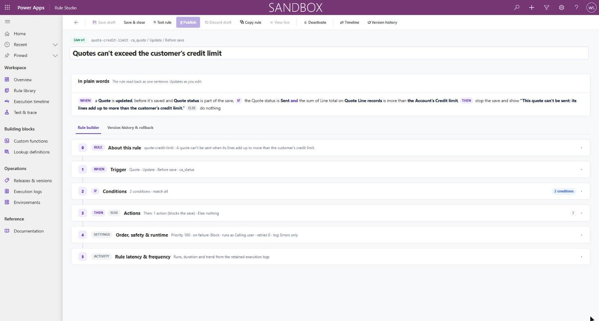
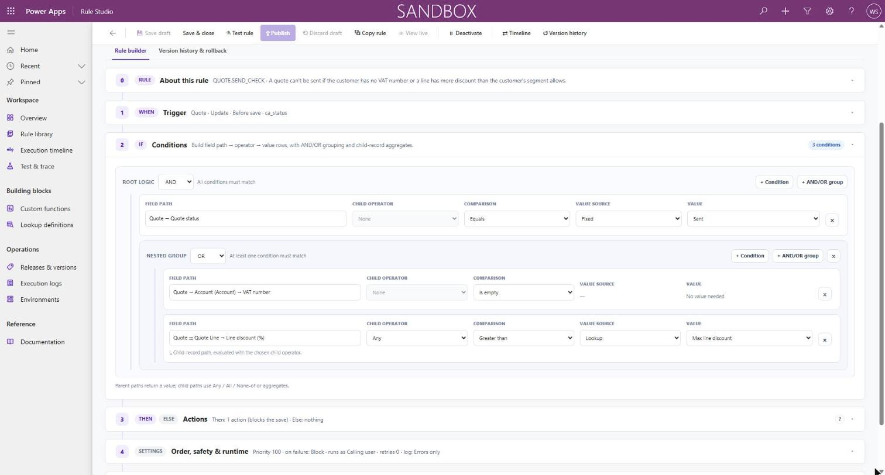
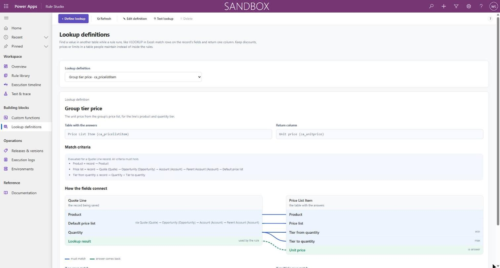
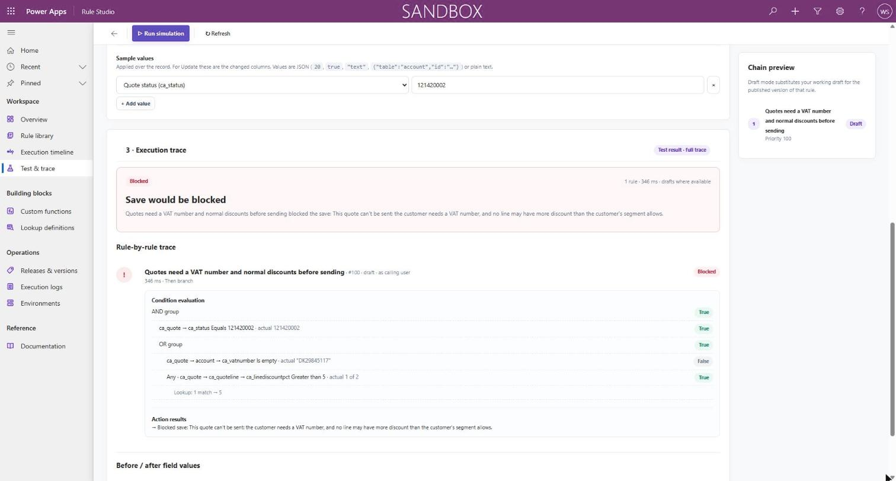
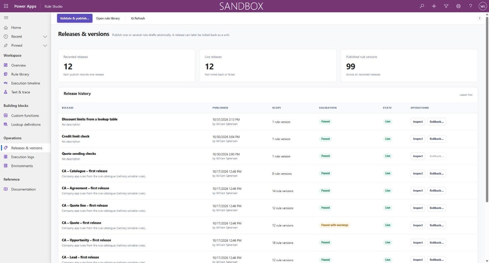

# Rule Studio

A no-code rule engine for Dataverse / Dynamics 365. Business users write IF / THEN / ELSE rules on
any table in a model-driven app; one generic plug-in runs the published rules when records are saved.

- **Rule editor:** trigger (table, event, before or after save), nested AND/OR conditions, and
  actions that set fields, block the save, log a message or call a custom function.
- **Value sources:** fixed values, field paths across lookups, NCalc expressions, lookup
  definitions on any table, and your own Custom APIs registered as functions.
- **Standard functions:** validate e-mail, phone and VAT numbers, create a task, assign a record
  and call a webhook, ready to register and use as examples for your own.
- **Test & trace:** run drafts against a real or sample record without saving anything.
- **Releases:** validate and publish rules together, roll back a release, restore an older version.
- **Execution logs and timeline:** see which rules ran on a save, in what order, and why.
- **Environments:** export the published rules and import them elsewhere with a three-way merge.

## Screenshots

**Conditions:** field paths across parents and child records, nested AND/OR groups, and values
from a lookup table.

**Lookup definitions:** keep prices, discounts or limits in a table the business maintains;
rules read the matching row when they run.

**Test & trace:** run a draft against a real record and see each condition's actual value.
Nothing is written.

**Releases:** every publish is validated and recorded as a release that can be rolled back.

## Getting started

To try it, import the unmanaged solution [`RuleStudioApp/Solution/RuleStudio.zip`](RuleStudioApp/Solution/RuleStudio.zip)
into a Dataverse environment where you are System Administrator, then give users the
**Rule Studio Author** or **Rule Studio Viewer** role.

To build from source you need .NET 10 SDK and Node.js 24. Setup, deployment and development are
described in [RuleStudioApp/README.md](RuleStudioApp/README.md).

## Documentation

- [User guide](RuleStudioApp/docs/user-guide.md): every page of the app (also shown in the app itself)
- [Runtime engine](RuleStudioApp/docs/engine.md)
- [Custom APIs](RuleStudioApp/docs/custom-apis.md)
- [JSON formats](RuleStudioApp/docs/json-formats.md)
- [UI page standard](RuleStudioApp/docs/ui-standard.md)

## License

[MIT](LICENSE). Built on the [XrmBedrock](https://github.com/delegateas/XrmBedrock) template.
